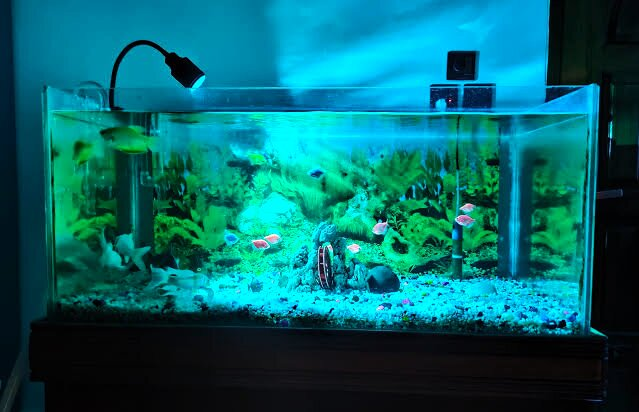
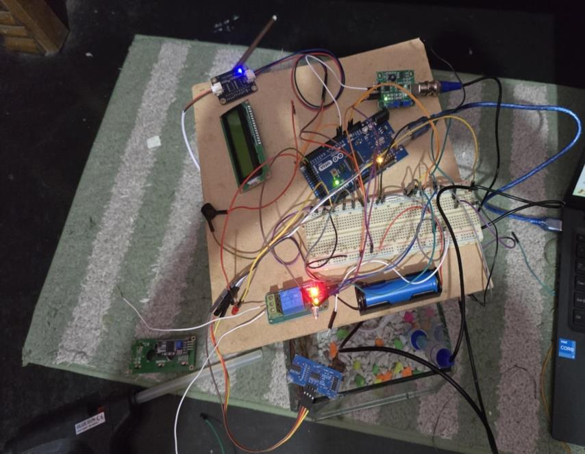
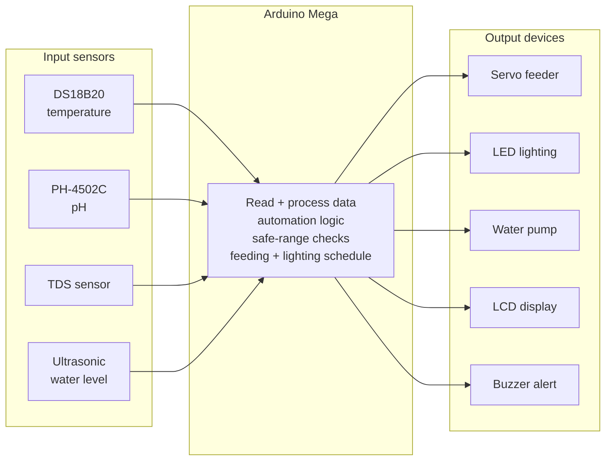

<h1 align="center">Automated Saltwater Aquarium</h1>
<h3 align="center">Arduino Mega controller for monitoring, feeding, lighting, water top-up and safety alerts</h3>

<p align="center">
  
  
  
  
</p>

<table align="center">
  <tr>
    <td align="center">
      <br>
      <sub><b>Salt Water Aquarium</b></sub>
    </td>
    <td align="center">
      <br>
  <sub>Salt Water Components Prototyping</sub>
    </td>
  </tr>
</table>

> **Project status - please read.** This was a university project (course *Electronics Laboratory, EEE 2124*, United
> International University, 2024). The original source code was **lost after submission**, so the firmware in this repository
> was **rebuilt in November 2026 from the project reports**: the 153-line code excerpt printed in the final report
> ([transcribed here](docs/original-code-from-report.ino.txt)), the system description, and the team's architecture and
> technology stack. It has been **compiled and tested on a PC simulator only** (200 automated checks). It has **not yet been run on
> the real board** - validate and calibrate everything on the bench before trusting it with live animals.

---

## Table of Contents

1. [About the project](#about-the-project)
2. [Features](#features)
3. [System architecture](#system-architecture)
4. [Hardware](#hardware)
5. [Firmware](#firmware)
6. [Getting started](#getting-started)
7. [Using the aquarium controller](#using-the-aquarium-controller)
8. [Calibration](#calibration)
9. [Tests](#tests)
10. [Project structure](#project-structure)
11. [Limitations and roadmap](#limitations-and-roadmap)
12. [Documentation](#documentation)
13. [Team](#team)

---

## About the project

Keeping a saltwater aquarium stable takes constant attention: temperature, pH and dissolved solids must stay in range,
feeding and lighting follow a rhythm, and the water level drops through evaporation. Manual care is time-consuming and
mistakes such as overfeeding can harm the animals.

The **Automated Saltwater Aquarium** uses an **Arduino Mega** to read four sensors, show the values on an LCD and automate
feeding, lighting, water top-up and alerts - creating a stable, low-maintenance habitat.

## Features

| # | Function | How |
|---|---|---|
| 1 | **Temperature monitoring** | DS18B20 probe, alarm outside the safe band |
| 2 | **pH monitoring** | PH-4502C module, averaged samples, two-point calibration saved in EEPROM |
| 3 | **Water-quality (TDS) monitoring** | TDS probe with temperature-compensated formula |
| 4 | **Water-level control** | Ultrasonic sensor + pump top-up with hysteresis, dry-run limit and overflow protection |
| 5 | **Automatic feeding** | Servo feeder on a schedule (08:00 / 18:00), max 4 feeds a day, 60 min gap |
| 6 | **Lighting control** | PWM LEDs with a day-night cycle and sunrise / sunset ramps |
| 7 | **Live display and alerts** | 16x2 LCD pages, serial console, buzzer alarm with mute |

Also: **manual-override buttons** (feed, light mode, page / mute), **sensor-fault detection**, a serial command line, and
optional heater and pH-dosing outputs (off by default).

## System architecture



| Layer | Technology |
|---|---|
| Controller | Arduino Mega 2560, C/C++ |
| Sensors | DS18B20, PH-4502C, TDS sensor, ultrasonic sensor |
| Actuators and display | Servo motor, water pump, LCD, LEDs, buzzer |

## Hardware

Parts, prices (5,350 BDT for the priced items), the pin map, wiring notes and safety advice are in
[`hardware/`](hardware/README.md) and [`hardware/bill_of_materials.csv`](hardware/bill_of_materials.csv).

| Function | Pin |
|---|---|
| DS18B20 / pH / TDS / buzzer | D2 / A0 / A1 / A11 *(as in the original code)* |
| Ultrasonic TRIG / ECHO | D22 / D23 |
| Feeder servo / LED PWM / pump relay | D9 / D5 / D24 |
| LCD I2C (SDA / SCL) | D20 / D21 |
| Buttons FEED / LIGHT / PAGE | D30 / D31 / D32 |

## Firmware

The sketch is split into small modules; everything you may want to change is in
[`config.h`](firmware/AutomatedSaltwaterAquarium/config.h).

| File | Role |
|---|---|
| `AutomatedSaltwaterAquarium.ino` | `setup()` / `loop()`, 1-second control tick, feeding, lighting, pump state machine, alarms |
| `config.h` | pins, safe-range profiles, schedules, level and pump limits, optional features |
| `logic.h` | pH / TDS formulas, alarm logic, light curve (pure functions, unit-tested) |
| `sensors.*` | non-blocking DS18B20, pH, TDS and ultrasonic readings |
| `actuators.*` | feeder, LED PWM, pump relay, buzzer, optional heater and dosing |
| `calibration.*` | pH and TDS calibration saved in EEPROM |
| `display.*`, `buttons.*`, `cli.*`, `aqclock.*` | LCD, buttons, serial commands, software clock |

**Safe ranges.** Choose a profile in `config.h` (`ACTIVE_PROFILE`):

| Parameter | `PROFILE_REPORT` (default) | `PROFILE_MARINE` |
|---|---|---|
| Temperature | 28 - 35 °C | 24 - 28 °C |
| pH | 6.32 - 6.80 | 8.00 - 8.40 |
| TDS | 300 - 400 ppm | alarm disabled |

The report's ranges are the values from the original code (demonstration water). A real marine tank needs the marine
profile and a proper salinity measurement - hobby TDS probes read only up to about 1000 ppm, far below seawater.

**Improvements over the original code:** the original `checkBuzzer()` used `&&` for the temperature and pH tests, which can
never be true (only TDS could trigger the buzzer) - fixed; TDS is sampled every 40 ms as intended; the loop no longer
blocks; calibration persists in EEPROM; missing sensors raise an alarm.

## Getting started

1. Install the [Arduino IDE](https://www.arduino.cc/en/software).
2. In **Library Manager** install **OneWire**, **DallasTemperature** and **LiquidCrystal I2C**
   (Servo, EEPROM and Wire are built in).
3. Open `firmware/AutomatedSaltwaterAquarium/AutomatedSaltwaterAquarium.ino`.
4. Check `config.h` (pins, profile, LCD address `0x27` / `0x3F`).
5. Select **Arduino Mega or Mega 2560** and your port, then **Upload**.
6. Open the **Serial Monitor at 9600 baud**, type `TIME HH:MM` to set the clock, and calibrate the probes.

## Using the aquarium controller

**LCD pages** (rotate every 4 s; the PAGE button advances at once):

| Page | Line 1 | Line 2 |
|---|---|---|
| Water | `T:30.0C pH:6.55` | `TDS: 334ppm OK` |
| Level and pump | `Lvl: 5.0cm OK` | `Pump:OFF Feed:0` |
| Time and light | `Time 12:00` | `Light:100% AUTO` |
| Alarm (alternates) | `!!   ALARM   !!` | `TEMP TOO HIGH` |

**Buttons:** FEED = feed now; LIGHT = AUTO / ON / OFF; PAGE = next page, hold 1.5 s = mute the buzzer.

**Serial commands (9600 baud):**

| Command | Action |
|---|---|
| `HELP`, `STATUS`, `PROFILE` | command list, full status, safe ranges |
| `FEED` | feed one portion now (overfeeding limits apply) |
| `LIGHT AUTO\|ON\|OFF`, `PUMP AUTO\|ON\|OFF\|RESET` | override modes |
| `TIME HH:MM` | set the clock (no RTC - set after every power-up) |
| `MUTE` | silence the buzzer for 10 minutes |
| `CALPH7`, `CALPH <pH>`, `CALTDS <ppm>`, `CALRESET` | calibration |

## Calibration

The report's default pH slope (-3.0) gives a reachable pH range of only about 6.17 to 7.83, so **calibrate the pH probe**:

1. Probe in **pH 7.00** buffer, wait for a stable reading, send `CALPH7`.
2. Probe in **pH 4.01** (or 9.18) buffer, wait, send `CALPH 4.01` (or `CALPH 9.18`).
3. Send `STATUS` to check. Values are saved in EEPROM.

For TDS, place the probe in a solution of known ppm and send `CALTDS <ppm>`.

## Tests

The tests compile the **real firmware** with g++ and run it against a simulated Arduino Mega (fake pins, timers, servo, LCD,
EEPROM and sensors) - 200 checks in 4 build configurations:

```bash
make -C tests test        # needs g++ and make (Linux, macOS, or WSL / MSYS2 on Windows)
```

Scenarios cover the formulas, alarms, buzzer and mute, feeding limits, lighting, the pump state machine and its lock-out,
EEPROM calibration, LCD and buttons, the serial commands, the marine profile and the optional heater / dosing outputs.
The simulator cannot replace bench tests on the real hardware.

## Project structure

```text
Automated-Saltwater-Aquarium-Arduino-Mega/
├── firmware/AutomatedSaltwaterAquarium/   # Arduino sketch (17 files, config.h = all settings)
├── tests/                                 # host simulator (mocks/), test_main.cpp, Makefile
├── hardware/                              # parts list (CSV), pin map, wiring and safety notes
├── docs/
│   ├── Automated_Saltwater_Aquarium_Complete_Project_Documentation.pdf
│   ├── original-code-from-report.ino.txt  # the surviving excerpt of the original code
│   └── images/                            # prototype photo, Gantt chart
└── README.md
```

## Limitations and roadmap

- [ ] Validate and calibrate on the real hardware (the rebuilt firmware has only been simulated)
- [ ] Real-time clock (DS3231) so schedules survive power cuts
- [ ] Remote monitoring and alerts (the proposal's mobile app / web interface)
- [ ] Dissolved-oxygen sensor (from the proposal) and a conductivity / salinity probe for seawater
- [ ] Heater / chiller control through a certified relay or SSR, with the W1209 as an independent safety thermostat
- [ ] Data logging, custom PCB and a waterproof enclosure

## Documentation

The complete project document - background, provenance of the rebuild, architecture, wiring, firmware design, algorithms,
calibration, user guide, test results, traceability to the report, and a viva guide - is in
[`docs/Automated_Saltwater_Aquarium_Complete_Project_Documentation.pdf`](docs/Automated_Saltwater_Aquarium_Complete_Project_Documentation.pdf).

## Team

Project of Group 04, Section B, Department of CSE, **United International University (UIU)**, Dhaka - course
*Electronics Laboratory (EEE 2124)*.

| Name | Role |
|---|---|
| **Kazi Shibli Zaman Rahil** - [@Rahil03-git](https://github.com/Rahil03-git) | **Project owner and main developer** |
| Hasan Al Banna | Team member |
| Sumaita Binte Hafiz | Team member |
| Md. Atiqur Rahman Rohid | Team member |
| Nazifa Tabassum | Team member |

<!-- Add GitHub links or roles, for example:
| Name - [@github-username](https://github.com/github-username) | role |
-->

---

<p align="center">Built with Arduino and C/C++.</p>
